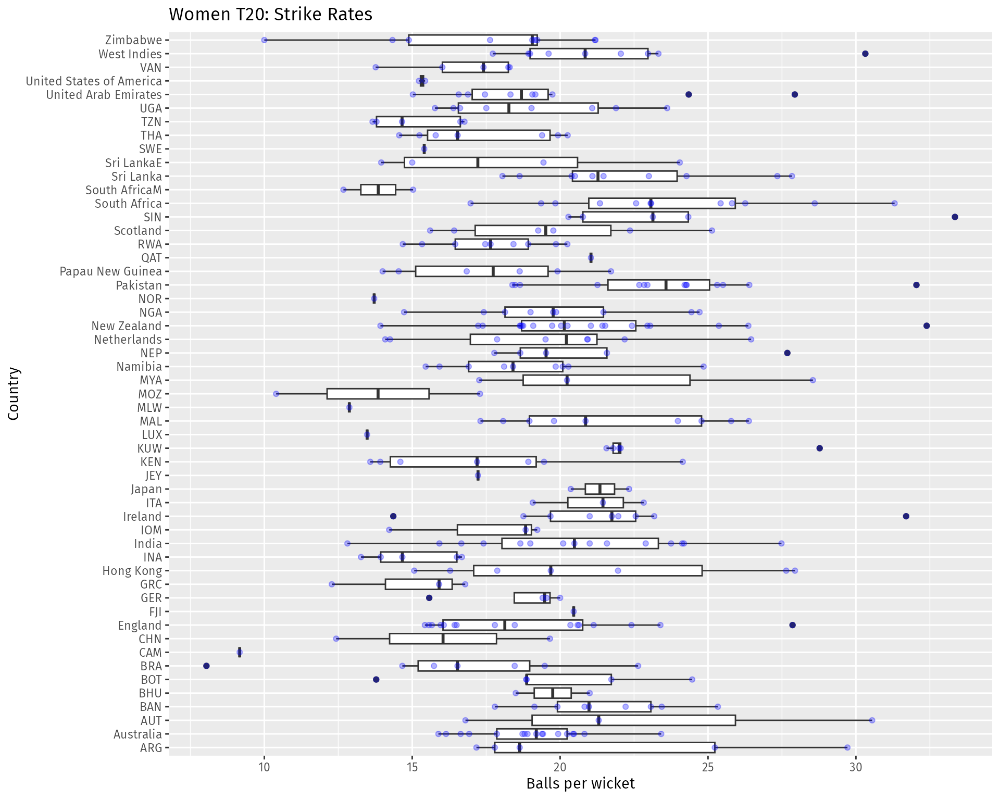
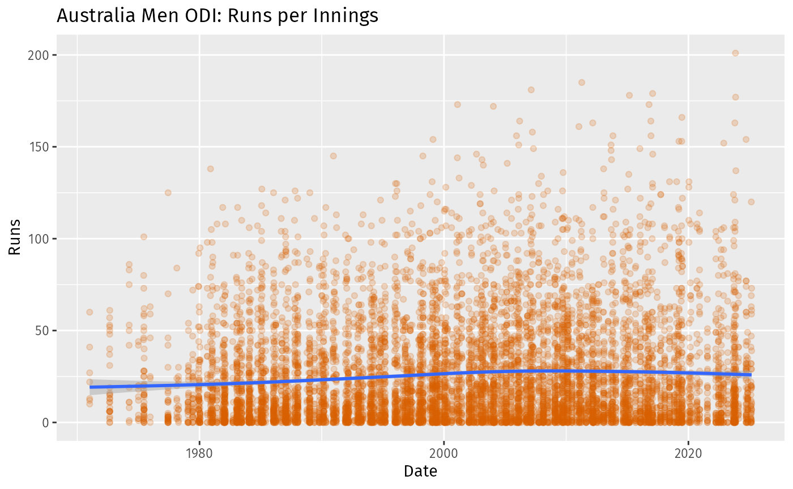
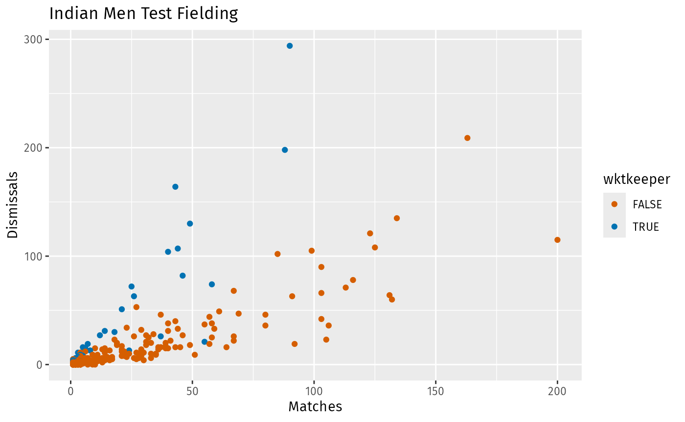
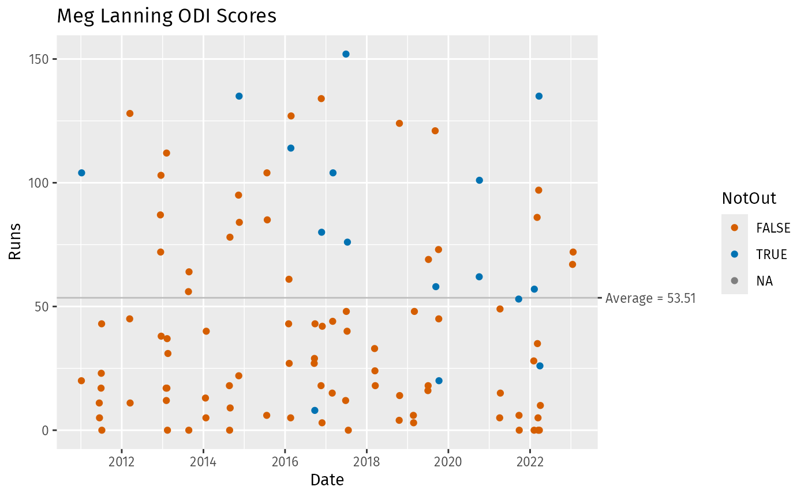

# ESPNCricinfo data

``` r

library(cricketdata)
library(dplyr)
#> 
#> Attaching package: 'dplyr'
#> The following objects are masked from 'package:stats':
#> 
#>     filter, lag
#> The following objects are masked from 'package:base':
#> 
#>     intersect, setdiff, setequal, union
library(ggplot2)
```

The
[`fetch_cricinfo()`](http://pkg.robjhyndman.com/cricketdata/reference/fetch_cricinfo.md)
function will fetch data on all international cricket matches provided
by ESPNCricinfo. Please respect the [ESPNCricinfo terms of
use](https://www.espncricinfo.com/ci/content/site/company/terms_use.html)
when using this function.

Here are some examples of its use.

## Women’s T20 bowling data

``` r

# Fetch all Women's T20 data
wt20 <- fetch_cricinfo("T20", "Women", "Bowling")
```

| Player | Country | Start | End | Matches | Innings | Overs | Maidens | Runs | Wickets | Average | Economy | StrikeRate | BestBowlingInnings | FourWickets | FiveWickets |
|:---|:---|---:|---:|---:|---:|---:|---:|---:|---:|---:|---:|---:|:---|---:|---:|
| M Schutt | Australia | 2013 | 2025 | 122 | 121 | 413.1 | 10 | 2632 | 149 | 17.66 | 6.37 | 16.64 | 5/15 | 4 | 1 |
| Nida Dar | Pakistan | 2010 | 2024 | 160 | 152 | 510.2 | 13 | 2910 | 144 | 20.21 | 5.70 | 21.26 | 5/21 | 1 | 1 |
| DB Sharma | India | 2016 | 2024 | 124 | 121 | 436.5 | 12 | 2642 | 138 | 19.14 | 6.05 | 18.99 | 4/10 | 1 | 0 |
| S Ecclestone | England | 2016 | 2025 | 96 | 95 | 355.2 | 10 | 2089 | 137 | 15.25 | 5.88 | 15.56 | 4/18 | 2 | 0 |
| N Boochatham | THA | 2018 | 2025 | 99 | 98 | 331.4 | 23 | 1363 | 126 | 10.82 | 4.11 | 15.79 | 5/5 | 5 | 1 |
| EA Perry | Australia | 2008 | 2025 | 167 | 137 | 407.5 | 8 | 2385 | 126 | 18.93 | 5.85 | 19.42 | 4/12 | 4 | 0 |

``` r

wt20 |>
  filter(Wickets > 20, !is.na(Country)) |>
  ggplot(aes(y = StrikeRate, x = Country)) +
  geom_boxplot() +
  geom_point(alpha = 0.3, col = "blue") +
  ggtitle("Women T20: Strike Rates") +
  ylab("Balls per wicket") +
  coord_flip()
```



## Australian men’s ODI data by innings

``` r

# Fetch all Australian Men's ODI data by innings
menODI <- fetch_cricinfo("ODI", "Men", "Batting", type = "innings", country = "Australia")
```

| Date | Player | Runs | NotOut | Minutes | BallsFaced | Fours | Sixes | StrikeRate | Innings | Participation | Opposition | Ground |
|:---|:---|---:|:---|---:|---:|---:|---:|---:|---:|:---|:---|:---|
| 2023-11-07 | GJ Maxwell | 201 | TRUE | 181 | 128 | 21 | 10 | 157.0312 | 2 | B | Afghanistan | Wankhede |
| 2011-04-11 | SR Watson | 185 | TRUE | 113 | 96 | 15 | 15 | 192.7083 | 2 | B | Bangladesh | Mirpur |
| 2007-02-20 | ML Hayden | 181 | TRUE | 227 | 166 | 11 | 10 | 109.0361 | 1 | B | New Zealand | Hamilton |
| 2017-01-26 | DA Warner | 179 | FALSE | 186 | 128 | 19 | 5 | 139.8438 | 1 | B | Pakistan | Adelaide |
| 2015-03-04 | DA Warner | 178 | FALSE | 164 | 133 | 19 | 5 | 133.8346 | 1 | B | Afghanistan | W.A.C.A |
| 2023-11-11 | MR Marsh | 177 | TRUE | 177 | 132 | 17 | 9 | 134.0909 | 2 | B | Bangladesh | Pune |

``` r

menODI |>
  ggplot(aes(y = Runs, x = Date)) +
  geom_point(alpha = 0.2, col = "#D55E00") +
  geom_smooth() +
  ggtitle("Australia Men ODI: Runs per Innings")
```



## Indian test fielding data

``` r

Indfielding <- fetch_cricinfo("Test", "Men", "Fielding", country = "India")
```

| Player | Start | End | Matches | Innings | Dismissals | Caught | CaughtFielder | CaughtBehind | Stumped | MaxDismissalsInnings |
|:---|---:|---:|---:|---:|---:|---:|---:|---:|---:|---:|
| MS Dhoni | 2005 | 2014 | 90 | 166 | 294 | 256 | 0 | 256 | 38 | 6 |
| R Dravid | 1996 | 2012 | 163 | 299 | 209 | 209 | 209 | 0 | 0 | 3 |
| SMH Kirmani | 1976 | 1986 | 88 | 151 | 198 | 160 | 0 | 160 | 38 | 6 |
| RR Pant | 2018 | 2025 | 43 | 85 | 164 | 149 | 0 | 149 | 15 | 6 |
| VVS Laxman | 1996 | 2012 | 134 | 248 | 135 | 135 | 135 | 0 | 0 | 4 |
| KS More | 1986 | 1993 | 49 | 90 | 130 | 110 | 0 | 110 | 20 | 5 |

``` r

Indfielding |>
  mutate(wktkeeper = (CaughtBehind > 0) | (Stumped > 0)) |>
  ggplot(aes(x = Matches, y = Dismissals, col = wktkeeper)) +
  geom_point() +
  ggtitle("Indian Men Test Fielding")
```



## Meg Lanning’s ODI batting

``` r

meg_lanning_id <- find_player_id("Meg Lanning")$ID
MegLanning <- fetch_player_data(meg_lanning_id, "ODI") |>
  mutate(NotOut = (Dismissal == "not out")) |>
  mutate(NotOut = tidyr::replace_na(NotOut, FALSE))
```

| Date | Innings | Opposition | Ground | Runs | Mins | BF | X4s | X6s | SR | Pos | Dismissal | Inns | NotOut |
|:---|---:|:---|:---|---:|---:|:---|:---|:---|:---|:---|:---|---:|:---|
| 2011-01-05 | 1 | ENG Women | W.A.C.A | 20 | 60 | 38 | 2 | 0 | 52.63 | 2 | caught | 1 | FALSE |
| 2011-01-07 | 2 | ENG Women | W.A.C.A | 104 | 148 | 118 | 8 | 1 | 88.13 | 2 | not out | 2 | TRUE |
| 2011-06-14 | 2 | NZ Women | Brisbane | 11 | 15 | 14 | 2 | 0 | 78.57 | 2 | bowled | 2 | FALSE |
| 2011-06-16 | 1 | NZ Women | Brisbane | 5 | 8 | 8 | 1 | 0 | 62.50 | 2 | caught | 1 | FALSE |
| 2011-06-30 | 1 | NZ Women | Chesterfield | 17 | 24 | 20 | 3 | 0 | 85.00 | 2 | caught | 1 | FALSE |
| 2011-07-02 | 2 | India Women | Chesterfield | 23 | 40 | 32 | 3 | 0 | 71.87 | 2 | run out | 2 | FALSE |

``` r

# Compute batting average
MLave <- MegLanning |>
  summarise(
    Innings = sum(!is.na(Runs)),
    Average = sum(Runs, na.rm = TRUE) / (Innings - sum(NotOut, na.rm=TRUE))
  ) |>
  pull(Average)
names(MLave) <- paste("Average =", round(MLave, 2))
# Plot ODI scores
ggplot(MegLanning) +
  geom_hline(aes(yintercept = MLave), col = "gray") +
  geom_point(aes(x = Date, y = Runs, col = NotOut)) +
  ggtitle("Meg Lanning ODI Scores") +
  scale_y_continuous(sec.axis = sec_axis(~., breaks = MLave))
#> Warning: Removed 1 row containing missing values or values outside the scale range
#> (`geom_point()`).
```


