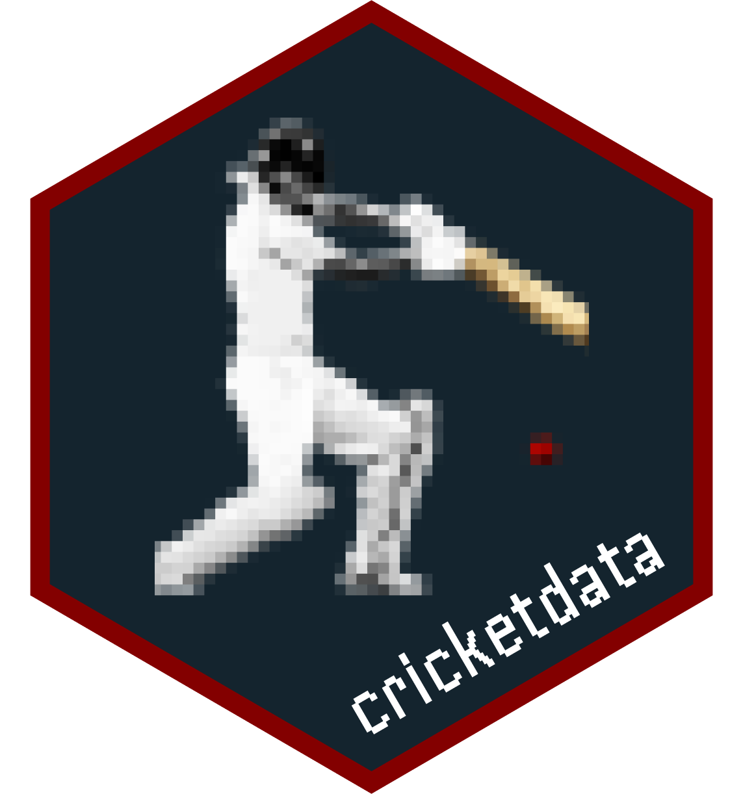

# cricketdata 

Functions for downloading data on international and other major cricket
matches from [ESPNCricinfo](https://www.espncricinfo.com) and
[Cricsheet](https://cricsheet.org). This package provides some functions
to download the data into tibbles ready for analysis.

Please respect the terms of use for each website:
[ESPNCricinfo](https://www.espncricinfo.com/ci/content/site/company/terms_use.html),
[Cricsheet](https://cricsheet.org/register/).

## Installation

You can install the **stable** version from
[CRAN](https://cran.r-project.org/package=cricketdata).

``` r

# install.packages("pak")
pak::pak("cricketdata")
```

You can install the **development** version
[Github](https://github.com/robjhyndman/cricketdata):

``` r

pak::pak("robjhyndman/cricketdata")
```

## License

This package is free and open source software, licensed under GPL-3.
